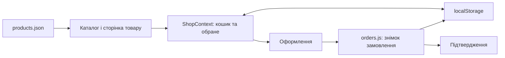

# Сувенірна крамниця

Навчальний інтернет-магазин сувенірів з українських міст: листівок, чашок, значків, постерів і виробів місцевих майстрів. Користувач зможе знайти товар, додати його в обране або кошик та оформити демонстраційне замовлення.

Клієнтська частина на React і JavaScript, з Vite, React Router, SCSS та ESLint. Готові адаптивна головна та каталог із пошуком, фільтрами, сортуванням і пагінацією по 9 товарів. На головній є слайдер, чотири рекомендовані товари та блок про крамницю. Контент прокручується окремо від шапки й підвалу. [Макети сторінок](design/README.md) збережені поруч із кодом.

На сторінці товару можна переглянути фото, вибрати кількість і додати сувенір у кошик. Кошик і обране зберігаються у localStorage. Контакти та оформлення ще в роботі.

## Запуск

Потрібен Node.js 22.13+; також підійдуть новіші парні LTS-версії.

```sh
cd project
npm ci
npm run dev
```

Адресу сайту Vite покаже в терміналі. `npm run lint` перевіряє код, `npm run build` створює production-збірку в `dist/`, `npm run preview` відкриває її локально. Для розміщення на хостингу потрібно налаштувати повернення `index.html` для маршрутів React Router.

Стрілки й точки перемикають слайди. Кнопка паузи зупиняє автоперемикання; наведення або фокус усередині слайдера тимчасово його призупиняє. За ввімкненого зменшення анімації слайдер починає роботу на паузі.

Зображення демонстраційних товарів згенеровані через image_gen та збережені локально у WebP. [Промпти](design/asset-prompts.json) також є в репозиторії.

## Сторінки

| Адреса | Що на ній буде |
| --- | --- |
| `/` | Слайдер, категорії, рекомендовані товари та блок про крамницю |
| `/catalog` | Пошук, фільтри за містом, категорією й ціною, сортування та пагінація |
| `/catalog/:productId` | Фото, опис, ціна, вибір кількості, кнопки кошика й обраного |
| `/favorites` | Збережені товари |
| `/cart` | Зміна кількості, видалення товарів і загальна сума |
| `/checkout` | Контактні дані, доставка та перевірка полів |
| `/order-success/:orderId` | Підтвердження і склад демозамовлення |
| `/contacts` | Демонстраційні контакти, карта з позначкою та відповіді про доставку |

Для невідомої адреси покажемо сторінку 404, для відсутнього товару або замовлення повідомлення з переходом до каталогу. Блок «Про нас» буде на головній.

## Параметри каталогу

Пошук `q` перевіряє назву без урахування регістру. Можна обрати кілька міст і категорій: усередині однієї групи достатньо одного збігу, між групами мають виконуватися всі умови. Ціну вводимо у гривнях, із крапкою або комою; межі включені в діапазон.

Адреса зберігає `q`, повторювані `city` та `category`, межі `min` і `max`, `sort` та `page`. Наприклад: `/catalog?category=mugs&min=450&max=600&sort=price-asc`. Після зміни запиту, фільтрів або сортування відкривається перша сторінка. Невідомі фільтри ігноруються, завеликий номер сторінки замінюється останнім доступним. Скидання фільтрів залишає пошук і сортування; кнопка «Показати всі товари» очищує всі параметри.

На телефоні фільтри відкриваються окремою кнопкою над результатами. На широкому екрані вони розташовані ліворуч і мають власну прокрутку, якщо не вміщаються за висотою.

## Структура файлів

```text
project/
├── README.md
├── task/                      # PDF із завданням
├── design/                    # Макети та промпти
├── public/
│   └── images/
│       ├── products/          # Фото товарів, підпапка на кожен id
│       └── banners/           # Зображення слайдера
├── src/
│   ├── main.jsx               # Запуск React
│   ├── App.jsx                # Маршрути та підключення спільного стану
│   ├── pages/                 # HomePage, CatalogPage, ProductPage тощо
│   ├── components/
│   │   ├── layout/            # Шапка, меню з підменю, footer, breadcrumbs
│   │   ├── catalog/           # Картка товару, фільтри, сортування, пагінація
│   │   ├── cart/              # Рядок кошика та підсумок
│   │   └── ui/                # Спільні поля форми, кількість, порожній стан
│   ├── context/
│   │   └── ShopContext.jsx    # Кошик, обране та дії з ними
│   ├── data/
│   │   └── products.json      # Єдиний каталог товарів
│   ├── services/
│   │   ├── storage.js         # Читання й запис localStorage, обробка помилок
│   │   └── orders.js          # Створення та читання демозамовлень
│   ├── utils/
│   │   ├── catalog.js         # Пошук, фільтрація, сортування
│   │   └── formatPrice.js     # Відображення ціни у гривнях
│   └── styles/
│       ├── _variables.scss    # Кольори, шрифти, відступи
│       └── main.scss          # Загальні стилі й адаптивність
├── index.html
├── package.json
├── package-lock.json
├── vite.config.js
└── eslint.config.js
```

Стилі окремих сторінок і компонентів триматимемо поруч із відповідними JSX-файлами. Залежності та зібрані файли (`node_modules/`, `dist/`) до Git не додаватимемо.

## Дані та стан

У `products.json` є 30 демонстраційних позицій: чотири колекції з варіантами розміру й кількості в наборі. Варіанти однієї колекції використовують спільне фото. Кожен матиме `id`, назву, опис, місто, категорію, ціну, список шляхів до фото, доступну кількість і ознаку рекомендації. Ціни зберігатимемо цілими числами в копійках, а показуватимемо у гривнях. Усі сторінки братимуть назви й ціни з цього каталогу.

| Де | Що зберігаємо |
| --- | --- |
| Параметри адреси каталогу | Пошуковий запит, фільтри, сортування і номер сторінки |
| `localStorage: souvenir-shop:cart:v1` | Пари `productId` і `quantity` |
| `localStorage: souvenir-shop:favorites:v1` | Список id обраних товарів |
| `localStorage: souvenir-shop:orders:v1` | Id, дата, товари, їхні назви й ціни на момент замовлення, кількість і сума |
| Стан форми React | Ім’я, телефон, email та адреса доставки під час оформлення |

Контактні дані після оформлення не зберігатимемо. Демозамовлення залишатимуться в цьому браузері; очищення його сховища видалить їх.



Після зміни фільтрів повертатимемося на першу сторінку. Послідовність обробки каталогу: пошук і фільтри, сортування, поділ на сторінки по 9 товарів.

Перед збереженням замовлення повторно перевірятимемо кількість і суму. Кошик очищатимемо після успішного запису. Якщо сховище недоступне або містить пошкоджені дані, покажемо зрозуміле повідомлення; успішне оформлення без збереження не показуватимемо.

## Що врахувати під час реалізації

Шапка матиме слайдер, горизонтальне меню з вертикальними розділювачами та підменю. Основний контент прокручуватиметься окремо. Галерею зробимо з комірками 300 × 300 px; на вузьких екранах вони вміщатимуться в доступну ширину без горизонтальної прокрутки. Для контактів підключимо карту, а адресу й посилання на неї залишимо видимими, якщо карта не завантажиться.

Наступний етап: сторінка товару, потім кошик, обране та оформлення.

Поточну головну перевірено в Chrome на ширинах 320, 375, 390, 768, 1024 та 1440 px: підменю, переходи, 404, прокрутку контенту, квадратні фото й керування слайдером. Для каталогу перевірено поєднання пошуку, фільтрів і сортування, діапазони цін, порожній результат, пагінацію, оновлення сторінки та історію браузера. Окремо пройдені `npm test`, ESLint і production-збірка. Перевірку Safari та Firefox ще не виконували.
